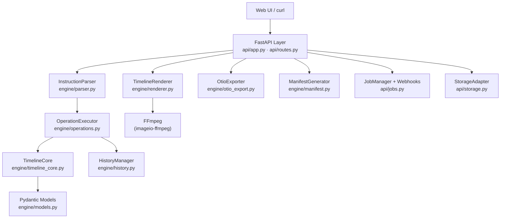

# Prompt-Based Video Editing Engine
### IncuBrix Engineering Assessment 2 — Software Engineer

A production-ready, prompt-driven video editing API that lets editors describe edits in plain English. The engine parses natural language instructions, maintains a content-anchored timeline with full undo/redo history, and renders edited video via FFmpeg.

---

## Table of Contents
1. [Architecture Overview](#architecture-overview)
2. [Quick Start](#quick-start)
3. [Running Tests](#running-tests)
4. [API Usage](#api-usage)
5. [Batch Runner](#batch-runner)
6. [Session YAML Runner](#session-yaml-runner)
7. [Live Demo UI](#live-demo-ui)
8. [Docker](#docker)
9. [Configuration](#configuration)
10. [Error Codes](#error-codes)
11. [Design Decisions](#design-decisions)

---

## Architecture Overview



### Key Components

| Module | Purpose |
|--------|---------|
| `engine/parser.py` | Deterministic regex-based NL parser; maps instructions to intents |
| `engine/timeline_core.py` | Content-anchored timeline; clip slicing; caption playout |
| `engine/history.py` | Snapshot-based immutable undo/redo; `restore_specific_edit()` |
| `engine/operations.py` | All editing operations with word-boundary snapping |
| `engine/time_policy.py` | Bidirectional original ↔ current time mapping; natural language time parsing |
| `engine/transcript.py` | Mock STT provider; transcript analysis (silence, fillers, speaker diarization) |
| `engine/renderer.py` | FFmpeg-based real render + synthetic fallback |
| `engine/otio_export.py` | OpenTimelineIO `.otio` export |
| `engine/manifest.py` | Integration Standard 9 manifest generation |
| `api/routes.py` | All REST endpoints (sessions, instructions, render, jobs, export, storage) |
| `api/jobs.py` | Async job queue with HMAC-SHA256 webhook signing |

---

## Quick Start

### Prerequisites
- Python 3.10+
- No system-level FFmpeg needed (bundled via `imageio-ffmpeg`)

### Install Dependencies
```bash
pip install -r requirements.txt
```

### Generate Test Media
```bash
python -m test_pack.media.generate_assets
```
This creates 5 synthetic media files in `test_pack/media/`:
- `single_speaker_interview.mp4` — 240 s, 30 fps, with audio
- `two_speaker_podcast.mp4` — 30 s, 30 fps, two-speaker audio
- `phone_vfr_video.mp4` — 15 s, 24 fps, variable frame rate
- `no_audio_video.mp4` — 10 s, 30 fps, no audio track
- `ambient_music.wav` — 60 s ambient tone

### Start the API Server
```bash
python api/app.py
# or
uvicorn api.app:app --host 0.0.0.0 --port 8000 --reload
```

### Open the Live Demo UI
```
http://localhost:8000
```

---

## Running Tests

```bash
# Run all 80 tests (single command)
python -m tests.run_all
```

Expected output:
```
Running: MustHave Tests ....... OK (8 tests)
Running: WorkedExample Tests ... OK (1 tests)
Running: HardCase Tests ........ OK (7 tests)
Running: Level Tests ........... OK (9 tests)
Running: Integration Tests ..... OK (10 tests)
Running: Scenario Suite ........ OK (45 tests)
------------------------------------------------------------
TOTAL: 80/80 OK
```

Individual suites:
```bash
python -m tests.test_must_haves
python -m tests.test_worked_example
python -m tests.test_hard_cases
python -m tests.test_levels
python -m tests.test_integration
python -m tests.test_scenarios_suite
```

---

## API Usage

### 1. Create a Session
```bash
curl -X POST http://localhost:8000/api/v1/sessions \
  -H "Content-Type: application/json" \
  -H "Idempotency-Key: key-001" \
  -d '{
    "source_url": "file:///path/to/video.mp4",
    "metadata": {"title": "My Edit"}
  }'
```
Response `201 Created`:
```json
{
  "session_id": "sess_abc123",
  "status": "ready",
  "timeline": { ... },
  "message": "Session created"
}
```

### 2. Send an Instruction
```bash
curl -X POST http://localhost:8000/api/v1/sessions/sess_abc123/instructions \
  -H "Content-Type: application/json" \
  -d '{"instruction": "Cut from 0:10 to 0:30"}'
```
Three-way response:
- **APPLIED** — edit accepted and applied
- **CLARIFICATION** — engine needs more info (returns `options` list)
- **REJECTED** — instruction cannot be parsed (returns `reason`)

### 3. Undo / Redo
```bash
curl -X POST http://localhost:8000/api/v1/sessions/sess_abc123/instructions \
  -d '{"instruction": "undo"}'

curl -X POST http://localhost:8000/api/v1/sessions/sess_abc123/instructions \
  -d '{"instruction": "redo"}'
```

### 4. Trigger Render
```bash
curl -X POST http://localhost:8000/api/v1/sessions/sess_abc123/render \
  -H "Content-Type: application/json" \
  -d '{"format": "mp4", "webhook_url": "https://your.app/webhook"}'
```
Response `202 Accepted`:
```json
{"job_id": "job_xyz", "status": "queued", "poll_url": "/api/v1/jobs/job_xyz"}
```

### 5. Poll Render Job
```bash
curl http://localhost:8000/api/v1/jobs/job_xyz
```

### 6. Export OpenTimelineIO
```bash
curl http://localhost:8000/api/v1/sessions/sess_abc123/export/otio \
  -o timeline.otio
```

### 7. Health Checks
```bash
curl http://localhost:8000/health   # {"status":"ok"}
curl http://localhost:8000/ready    # {"status":"ready","ffmpeg":true}
```

### 8. Download Rendered File
```bash
curl http://localhost:8000/api/v1/storage/download/file_abc \
  -o output.mp4
```

---

## Batch Runner

Run multiple session YAML files in one command:

```bash
python -m engine.batch_runner \
  --input test_pack/sessions \
  --output-dir test_pack/outputs \
  --workers 4
```

Output per session in `test_pack/outputs/<session_id>/`:
- `results.json` — instruction responses
- `timeline.json` — final timeline state
- `manifest.json` — Integration Standard 9 manifest

---

## Session YAML Runner

Run a single session from a YAML file:
```bash
python -m engine.session_runner test_pack/sessions/session_01_basic_cuts.yaml
```

YAML format:
```yaml
session_id: session_01
source_url: "file:///path/to/video.mp4"
instructions:
  - "Cut from 0:10 to 0:30"
  - "Add a caption 'Hello World' at 0:05"
  - "undo"
```

---

## Live Demo UI

Open `http://localhost:8000` after starting the server.

Features:
- **Chat interface** — type any editing instruction
- **Timeline visualization** — see clips update in real time
- **Caption overlay** — captions shown on timeline
- **Undo/Redo buttons** — click or type `undo` / `redo`
- **Render button** — trigger render and download

---

## Docker

```bash
# Build and start (API + MinIO storage)
docker compose up

# API available at http://localhost:8000
# MinIO console at http://localhost:9001
```

Environment: see `.env.example` for all configuration variables.

---

## Configuration

Copy `.env.example` to `.env` and edit as needed:

```env
PORT=8000
STORAGE_BACKEND=local          # local | s3
S3_BUCKET=incubrix-renders
S3_ENDPOINT_URL=http://localhost:9000
WEBHOOK_SECRET=change-me-in-production
LOG_LEVEL=INFO
MAX_SESSION_DURATION_S=7200
MAX_RENDER_WORKERS=4
```

---

## Error Codes

All errors return JSON: `{"error": "<CODE>", "message": "...", "request_id": "..."}`

| Code | HTTP | Meaning |
|------|------|---------|
| `SESSION_NOT_FOUND` | 404 | Session ID does not exist |
| `JOB_NOT_FOUND` | 404 | Render job ID does not exist |
| `FILE_NOT_FOUND` | 404 | Storage file ID does not exist |
| `INVALID_SOURCE_URL` | 422 | Source URL missing or malformed |
| `MEDIA_PROBE_FAILED` | 422 | FFmpeg could not probe the media file |
| `INSTRUCTION_REQUIRED` | 422 | Instruction field missing or empty |
| `RENDER_IN_PROGRESS` | 409 | A render job is already running for this session |
| `INTERNAL_ERROR` | 500 | Unexpected server error (see `request_id` in logs) |

---

## Design Decisions

### 1. Content-Anchored Timeline
Every clip tracks its `source_start` and `source_end` in the **original** media file. After cuts and speed changes, the engine always knows exactly which frames to fetch — no cumulative drift.

### 2. Deterministic Parser
No LLM calls at parse time. A regex/rule-based `InstructionParser` gives deterministic, testable, sub-millisecond responses. This means:
- Latency: ~2 ms per instruction (no network round-trip)
- Cost: \$0 per instruction parse
- Reproducibility: same input always gives the same parse result

### 3. Three-Way Response
Every instruction returns one of three outcomes:
- **APPLIED** — unambiguous, executed immediately
- **CLARIFICATION** — ambiguous (e.g., "cut the boring part"), returns ranked options
- **REJECTED** — syntactically unrecognizable

### 4. Snapshot-Based Undo/Redo
Each history step stores a full `pre_snapshot` (and `post_snapshot` for redo). This is O(n) memory but guarantees perfect undo fidelity with zero cumulative state drift. `restore_specific_edit()` replays from any snapshot.

### 5. Word-Boundary Snapping
All time-based cuts snap to the nearest word boundary (from the transcript) to prevent mid-word cuts. If no transcript is available, cuts proceed at the exact requested time.

### 6. FFmpeg via imageio-ffmpeg
No system-level FFmpeg installation required. `imageio-ffmpeg` bundles a static binary that works on Windows, macOS, and Linux out of the box.

---

## Project Structure

```
INCUBRIX/
├── api/
│   ├── app.py              # FastAPI application
│   ├── routes.py           # All REST routes
│   ├── jobs.py             # Async job manager + webhooks
│   ├── storage.py          # Storage adapter (local/S3)
│   ├── idempotency.py      # Idempotency key store
│   └── logging_config.py   # Structured JSON logging
├── engine/
│   ├── models.py           # Pydantic data models
│   ├── parser.py           # NL instruction parser
│   ├── timeline_core.py    # Timeline operations
│   ├── history.py          # Undo/redo history
│   ├── operations.py       # Edit operation executor
│   ├── time_policy.py      # Time expression parsing
│   ├── transcript.py       # Mock STT + analysis
│   ├── renderer.py         # FFmpeg renderer
│   ├── otio_export.py      # OpenTimelineIO export
│   ├── manifest.py         # Integration manifest
│   ├── batch_runner.py     # CLI batch runner
│   ├── session_runner.py   # YAML session runner
│   └── config.py           # Settings via env vars
├── test_pack/
│   ├── media/              # Synthetic test media files
│   ├── sessions/           # 15 session YAML files
│   └── outputs/            # Batch runner outputs
├── tests/
│   ├── run_all.py          # Single-command test runner
│   ├── test_must_haves.py  # MH1–MH8
│   ├── test_worked_example.py
│   ├── test_hard_cases.py  # HC1–HC7
│   ├── test_levels.py      # Core/Advanced/Outstanding
│   ├── test_integration.py # Integration Standard 1–10
│   └── test_scenarios_suite.py  # 45 scenarios
├── web/
│   └── index.html          # Live demo UI
├── schema/
│   └── timeline.schema.json
├── .env.example
├── .gitignore
├── Dockerfile
├── docker-compose.yml
├── openapi.yaml
├── requirements.txt
├── README.md
├── REPORT.md
├── SOURCES.md
└── AI_USE.md
```

---

## Author

**Manikanta** — mmuddana6@gmail.com  
IncuBrix Engineering Assessment 2, November 2026

